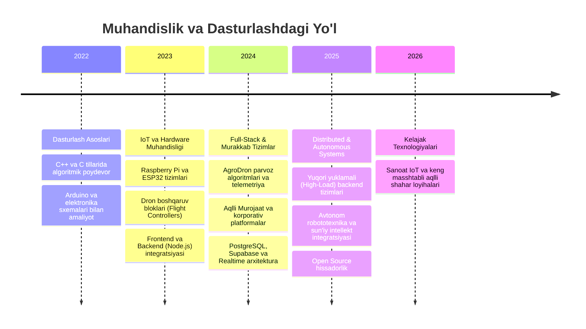

<div align="center">

  <!-- Header Banner -->
  

  <!-- Animated Typing Tagline -->
  <a href="https://github.com/durd1ma7ov06">
    
  </a>

  <br/>

  <!-- Status & Social Badges in Dark Aesthetic -->
  <p align="center">
    <a href="https://github.com/durd1ma7ov06">
      
    </a>
    
    
    
  </p>

</div>

---

### 👨🏻‍💻 Executive Summary / Men Haqimda

```yaml
developer:
  name: Mansur Durdimatov
  handle: durd1ma7ov06
  location: Uzbekistan 🇺🇿
  roles:
    - Full-Stack Software Engineer
    - Autonomous Drone & Robotics Developer
    - IoT & Embedded Systems Architect
  core_stack:
    backend: [Node.js, TypeScript, Java, Python, FastAPI, Express.js]
    hardware_iot: [C/C++, Arduino, Raspberry Pi, ESP32, STM32, PX4/ArduPilot]
    database: [PostgreSQL, Supabase, Redis, MongoDB]
    devops_cloud: [Docker, Linux/Ubuntu, Git, CI/CD, Nginx]
  architecture_principles: [Event-Driven, Clean Code, Real-Time WebSockets, Low-Latency Hardware Interfacing]
  quote: "Hardware without robust software is inert; software without hardware is abstract. We build the synergy."
```

---

### 🛠️ Tech Stack & Engineering Arsenal

#### 💻 Dasturlash Tillari (Programming Languages)
<p align="left">
  
</p>

#### ⚡ Backend, Frameworklar & Runtimes
<p align="left">
  
</p>

#### 🌐 Frontend & UI Kutubxonalari
<p align="left">
  
</p>

#### 🗄️ Ma'lumotlar Bazasi & Cloud Services
<p align="left">
  
</p>

#### 🤖 Hardware, IoT, Dronlar & Embedded Systems
<p align="left">
  
</p>

#### 🧠 DevOps, Asboblar & Sun'iy Intellekt
<p align="left">
  
</p>

---

### 🚀 Asosiy Loyihalar / Featured Projects Showcase

---

#### 🛸 1. AgroDron — Qishloq Xo'jaligi Uchun Avtonom Dron & Telemetriya Tizimi
> **Lead Embedded & Full-Stack Engineer** — Dron parvoz nazoratchisi, yerosti stansiyasi va real-vaqt telemetriyasi

- 📡 **Real-time Telemetry:** ESP32/STM32 orqali GPS, balandlik, batareya va tezlik parametrlarini real vaqtda WebSockets orqali uzatish.
- 🗺 **Autonomous Mission Planning:** Belgilangan koordinatalar bo'yicha ekin maydonlarini avtomatlashtirilgan tahlil qilish va purkash algoritmlari.
- ⚡ **Low-Latency Architecture:** C++ embedded drayverlari va Node.js markaziy boshqaruv serveri.
- 🏷 `C++` `ESP32` `Node.js` `WebSockets` `Autonomous Drones` `IoT Telemetry` `PostgreSQL`

---

#### 🏛️ 2. Aqlli Murojaat — Fuqarolar Murojaatlari va Tashkilotlar Boshqaruvi Portali
> **Full-Stack Architect** — Davlat va tashkilotlar uchun murojaatlarni avtomatlashtirilgan qayta ishlash platformasi

- 🔐 **Role-Based Access Control (RBAC):** Admin, Moderator, Bo'lim xodimlari va Fuqarolar uchun ko'p bosqichli xavfsiz autentifikatsiya.
- ⚡ **Real-Time Monitoring:** Murojaatlar statusining jonli yangilanishi, xabarnomalar va analitik hisobotlar.
- 📊 **Automated Routing:** Murojaat mavzusi bo'yicha mas'ul xodimlarga avtomatik biriktirish tizimi.
- 🏷 `TypeScript` `React` `Node.js` `PostgreSQL` `Supabase` `TailwindCSS`

---

#### ⚡ 3. Supabase Pro Studio & Multi-Database Manager
> **Creator & Developer** — PostgreSQL, Auth, Realtime Streams va Storage uchun to'liq interaktiv boshqaruv studiyasi

- 📑 **Visual CRUD & SQL Editor:** Tezkor PostgreSQL so'rovlari, jadvallarni real-vaqt tahrirlash va CSV eksport.
- 🔄 **Live Event Stream:** PostgreSQL o'zgarishlarini (`INSERT`, `UPDATE`, `DELETE`) real vaqtda jonli ko'rsatish.
- 🔒 **Row Level Security (RLS):** Avtomatlashtirilgan xavfsizlik shablonlari va foydalanuvchilar boshqaruvi.
- 🏷 `JavaScript` `Supabase SDK` `PostgreSQL` `Realtime WebSocket` `Glassmorphism UI`

---

<details>
<summary>📋 <b>Boshqa Muhandislik Loyihalari (Click to Expand)</b></summary>
<br>

| Loyiha Nomi | Tavsif | Ishlatilgan Texnologiyalar |
|:---|:---|:---|
| 🤖 **Smart FaceID & Attendance** | Face recognition datchiklari orqali avtomatlashtirilgan davomat va xodimlar hisobi | `Python` `OpenCV` `Raspberry Pi` `Node.js` |
| 🏡 **Smart Home IoT Controller** | Xonadonlar va ofislar uchun harorat, yoritish va xavfsizlikni masofadan boshqarish | `ESP32` `Arduino` `MQTT` `C++` `React` |
| 🛡️ **Cyber Recon & Security Tool** | Tarmoq xavfsizligi va portlar monitoringi uchun avtomatlashtirilgan diagnostika skripti | `Python` `Bash` `Linux` `Networking` |
| 📚 **English SRS Adaptive App** | Interval takrorlash (Spaced Repetition) asosida so'z boyligini oshiruvchi aqlli platforma | `TypeScript` `React` `Node.js` `PostgreSQL` |
| 🔌 **Industrial Sensor Gateway** | Sanoat datchiklaridan RS485 / Modbus protokoli orqali ma'lumotlarni bulutga yig'uvchi kontroller | `C++` `STM32` `RS485` `IoT Gateway` |

</details>

---

## 📜 Rasmiy Sertifikatlar, Loyihalar va Intellektual Mulk

| # | Hujjat / Loyiha Nomi | Yo'nalish | Holati |
|:-:|:---|:---:|:---|
| 1 | **AgroDron — Qishloq xo'jaligi avtonom dron tizimi** | `Dron Muhandisligi / IoT` | *Amaliyotga joriy etilgan* |
| 2 | **Aqlli Murojaat intellektual boshqaruv tizimi** | `Web & Enterprise Software` | *Faol ishlatilmoqda* |
| 3 | **Smart Attendance FaceID apparat-dasturiy majmuasi** | `Robotics & Computer Vision` | *Ishlab chiqilgan* |
| 4 | **IoT Telemetriya va Datchiklar Avtomatizatsiyasi** | `Embedded Systems` | *Sertifikatlangan* |

---

## 💼 Karyera va Rivojlanish Bosqichlari (Career Journey)



---

## 📊 GitHub Faollik & Statistikasi (Live Analytics)

<div align="center">

  <table border="0">
    <tr>
      <td width="50%">
        
      </td>
      <td width="50%">
        
      </td>
    </tr>
  </table>

  

  <br/><br/>

  

</div>

---

<div align="center">

### 🤝 Keling, Birgalikda Katta Loyihalar Yarataylik! / Let's Connect & Collaborate!

*Yangi loyihalar, texnologik startaplar, IoT/Dron muhandisligi yoki Full-Stack hamkorlik uchun har doim ochiqman.*

<br/>

<a href="https://t.me/durd1ma7ov" target="_blank">
  
</a>
&nbsp;&nbsp;
<a href="mailto:durdimatovmansur6@gmail.com" target="_blank">
  
</a>
&nbsp;&nbsp;
<a href="https://github.com/durd1ma7ov06" target="_blank">
  
</a>
&nbsp;&nbsp;
<a href="https://linkedin.com" target="_blank">
  
</a>

<br/><br/>

<sub>© 2024–2026 Mansur Durdimatov. Built with dedication, precision and passion for innovation. 🚀</sub>

<br/>


</div>
